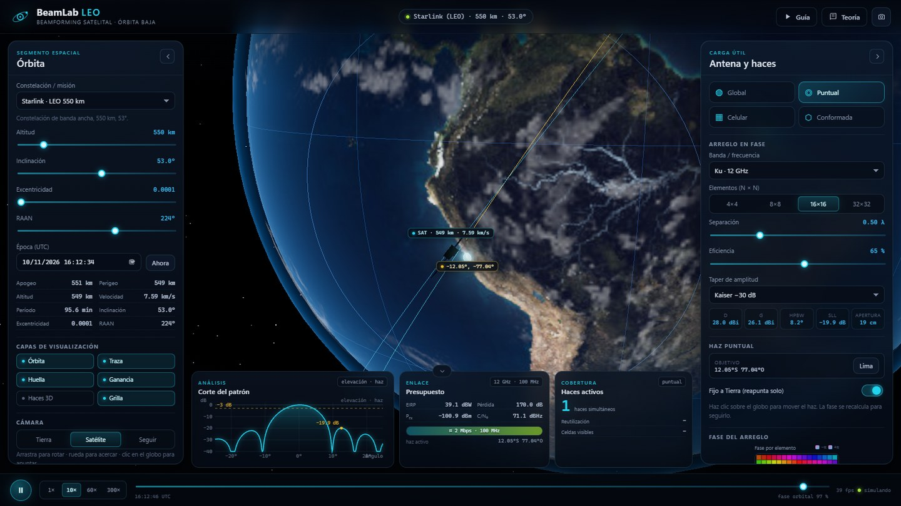
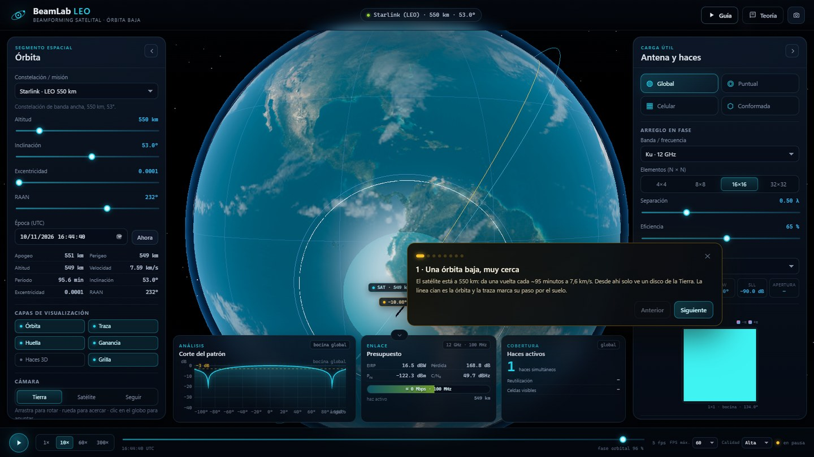

# BeamLab LEO

**Simulador interactivo de órbita, antenas en fase y _beamforming_ satelital.**

Un satélite LEO a 550 km se mueve a 7,6 km/s. Desde ahí “ve” un disco de la Tierra, y debe repartir su potencia en haces que apuntan a zonas concretas. Este proyecto hace visible ese proceso: la órbita, la geometría de la huella, la fase de cada elemento del arreglo, la cobertura celular y el diseño de un haz conformado.



> Proyecto para el curso **Comunicaciones Móviles y Satelitales**. Parte de la idea del apunte *Estructura de un satélite*: cobertura global con bocina, haces puntuales con reflector, cobertura conformada con múltiples alimentadores y cobertura celular de las constelaciones LEO.

---

## Qué se puede hacer

| Modo | Qué muestra | Qué enseña |
|---|---|---|
| **Global** | Una bocina de ~134° ilumina todo el disco visible | Un haz ancho cubre mucho, pero con muy poca ganancia (~5 dBi). La bocina de 17° del apunte cubre el disco **desde GEO**, no desde LEO. |
| **Puntual** | Un haz de un arreglo 16×16 sigue a Lima | La fase por elemento inclina el frente de onda. El mapa de fase muestra la rampa; la huella se mueve con el satélite. |
| **Celular** | ~287 haces pequeños sobre Perú, con 3 colores de reutilización | Las constelaciones LEO cubren con celdas. El satélite recalcula la fase de cada celda mientras la ve. |
| **Conformada** | Síntesis de amplitud y fase para iluminar Lima (100 km) | Se resuelve `(AᴴA+λI)w = Aᴴd` para cubrir la zona y anular el exterior. Es la versión digital de un reflector multi-alimentado. |

Además: presupuesto de enlace en vivo (EIRP, pérdida de espacio libre, C/N₀, capacidad), corte del patrón con HPBW y SLL, mapa de fase, y una **guía de presentación** de 8 pasos que configura todo automáticamente.


---

## Ejecutarlo

Requiere **Node.js 20+**.

```bash
npm install
npm run dev
```

Abre la URL que imprime Vite (por defecto `http://localhost:5173`).

Para la versión de producción:

```bash
npm run build
npm run preview
```

Pruebas del motor:

```bash
npm test
```

> El proyecto usa Three.js para el globo 3D, Vite + TypeScript para la app y KaTeX para las ecuaciones. No necesita conexión a internet una vez instalado.

### Atajos

| Tecla | Acción |
|---|---|
| `Espacio` | Reproducir / pausar |
| `1` … `4` | Global, puntual, celular, conformada |
| `G` | Mostrar / ocultar el mapa de ganancia |
| `[` / `]` | Mostrar / ocultar el panel de órbita / antena |
| `T` | Abrir la guía de presentación |
| `H` | Abrir la teoría |
| `P` | Descargar una captura |
| `Esc` | Cerrar guía o teoría |

En el globo: arrastra para rotar, rueda para acercar y **haz clic** para apuntar el haz (o para centrar la zona conformada).

---

## La física en cinco ideas

### 1. La órbita

Se propaga una órbita kepleriana con deriva secular **J2** (precesión del nodo y del perigeo). La posición pasa de ECI a ECEF con el tiempo sidéreo de Greenwich (GMST). La app muestra apogeo, perigeo, altitud, rapidez, período y la traza sobre el suelo.

### 2. El arreglo en fase

Un arreglo plano de `M×N` elementos separados `d` tiene un factor de arreglo

```
AF(u,v) = Σ_m Σ_n a_mn · exp[j k (x_m u + y_n v)]
```

donde `u = sinθ cosφ`, `v = sinθ sinφ`, `k = 2π/λ` y `a_mn` son las excitaciones complejas. La potencia es `|AF|²` multiplicada por el patrón del elemento (`cos^q θ`).

### 3. Apuntar es poner una fase

Para dirigir el máximo a `(u₀, v₀)`:

```
a_mn = w_m w_n · exp[−j k (x_m u₀ + y_n v₀)]
```

No se mueve la antena: se inclina el frente de onda. El mapa de fase muestra esa rampa; el haz se puede seguir en Tierra sin partes móviles.

### 4. De ángulo a huella

Un rayo desde el satélite corta la esfera terrestre. La huella a −3 dB es el conjunto de rayos dentro de ±HPBW/2. A nadir, `r ≈ h·tan(HPBW/2)`; al escanear, la huella se alarga y la distancia oblicua crece. Desde 550 km el horizonte está a 67° de nadir: un disco de ~4.500 km de radio.

### 5. Del patrón al enlace

```
EIRP = P_tx · G_tx
L_fs = 20 log10(4πd/λ)
C/N₀ = P_rx − N₀
```

La ganancia del haz entra directo en el EIRP; la distancia oblicua entra en la pérdida. Un haz más estrecho da más C/N₀ pero cubre menos área: ese es el compromiso central del diseño satelital.

La derivación completa, con las convenciones y los números de validación, está en **[docs/TEORIA.md](docs/TEORIA.md)**.

---

## Cómo está hecho

```
src/
  core/
    constants.ts   constantes (μ, R⊕, J2, c)
    vec.ts         álgebra vectorial mínima
    orbit.ts       Kepler, J2, GMST, ECI/ECEF, horizonte
    geometry.ts    cosenos directores, rayos, anillos de huella
    array.ts       factor de arreglo, taper, directividad, HPBW/SLL, mapas
    synthesis.ts   mínimos cuadrados complejos + gradiente conjugado
    coverage.ts    celdas, haces visibles, apuntamiento a Tierra
    regions.ts     polígonos, muestreo de regiones, celdas
    presets.ts     ISS, Starlink, OneWeb, SSO
    link.ts        presupuesto de enlace
  scene.ts          globo 3D, satélite, órbita, haces, shader de ganancia
  engine.ts         estado → órbita → patrón → haces → mapa → enlace
  charts.ts         mapa de fase y corte de patrón en canvas
  ui.ts             controles, métricas, tour y teoría
  main.ts           carga de texturas, bucle y manejadores
  state.ts          estado y tipos derivados
tests/              16 pruebas del motor
docs/               teoría, guion y capturas
public/assets/      texturas de la Tierra
```

El motor calcula un objeto `Derived` por cuadro: estado orbital, base de antena, patrón, métricas, haces, mapa de ganancia, fase y enlace. La escena 3D consume ese objeto y el shader del globo pinta la ganancia en la dirección de cada píxel.

> **Detalle de implementación:** la base de la antena es **este/norte/nadir** en ECEF, mientras que el modelo 3D del satélite se orienta con la **velocidad** (a lo largo de la traza). Son bases distintas: el shader debe usar la primera, rotada por GMST. Mezclarlas produce un patrón rotado (y fue uno de los bugs que se corrigieron en el desarrollo).

---

## Guía de presentación

El botón **Guía** (o `T`) recorre ocho pasos y configura la simulación sola:

1. Órbita LEO y parámetros.
2. Huella visible y haz global.
3. Haz puntual sobre Lima y fase.
4. 4×4: haz ancho, poca ganancia.
5. 16×16: haz estrecho, ~29 dBi.
6. Cobertura celular de Perú y reutilización.
7. Haz conformado sobre Lima (síntesis).
8. Presupuesto de enlace y compromiso ganancia/cobertura.

El guion detallado, con tiempos y frases sugeridas, está en **[docs/GUION_EXPOSICION.md](docs/GUION_EXPOSICION.md)**.



---

## Pruebas y validación

`npm test` ejecuta 16 pruebas:

- **Órbita:** GMST en J2000, período y rapidez de la ISS, paso sobre Lima, deriva J2, elevación.
- **Arreglo:** bocina de 17° (21 dBi), 16×16 uniforme (≈29 dBi, HPBW 6,3°), efecto del taper, fase de apuntamiento, corte del patrón.
- **Síntesis:** cobertura de una zona suave y, con geometría real desde 550 km, cobertura >90 % de una zona de 100 km sobre Lima con derrame < −12 dB.

---

## Limitaciones (honestas)

- Tierra esférica, sin elipsoide, relieve ni atmósfera.
- Arreglo ideal: sin acoplamiento mutuo, errores de fase/cuantización ni pérdidas de alimentación. La eficiencia se aplica como factor global.
- El patrón se evalúa en campo lejano; no hay enfoque de campo cercano.
- En cobertura celular los haces son fijos a Tierra y se recalculan mientras el satélite los ve; no se modelan traspaso, interferencia entre celdas ni potencia adaptativa.
- La síntesis conformada usa pesos complejos con regularización; los lóbulos laterales pueden quedar alrededor de −18 dB. La visualización del globo muestra el lóbulo principal (umbral −7 dB) para no tapar la Tierra con sidelobes.
- El presupuesto de enlace es de espacio libre, sin lluvia, multitrayecto ni modulación concreta. La “capacidad” es una estimación tipo Shannon, no un cálculo de throughput real.
- Las cifras son docentes y realistas, no certificadas para diseño de vuelo.

---

## Créditos

- Texturas de la Tierra: ejemplos de **Three.js** (NASA Visible Earth, dominio público). Ver [public/assets/CREDITS.md](public/assets/CREDITS.md).
- [Three.js](https://threejs.org/) (MIT), [KaTeX](https://katex.org/) (MIT), [Vite](https://vitejs.dev/) (MIT).
- Contexto conceptual: apunte *Comunicaciones por Satélite — Estructura de un satélite*, Ing. Jorge Luis Mogrovejo Carpio, PUCP.
- Referencias: Balanis, *Antenna Theory*; Mailloux, *Phased Array Antenna Handbook*; Maral & Bousquet, *Satellite Communications Systems*; Vallado, *Fundamentals of Astrodynamics*; ITU-R S.580/S.465.

## Licencia

MIT. Úsalo, modifícalo y preséntalo; si te sirve, menciona el proyecto.
