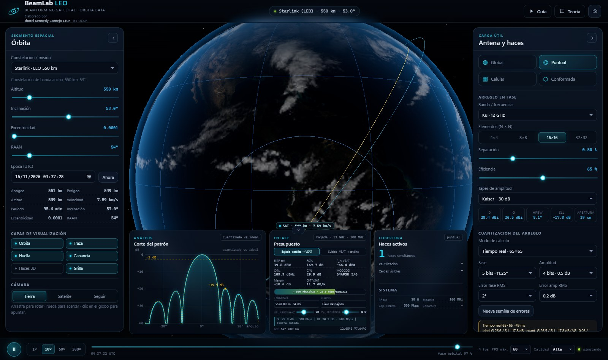

# BeamLab LEO

Simulador de órbita baja, arreglos en fase y enlace satelital.

[Demo](https://gcrownv-glitch.github.io/beamlab-leo/) · [Versiones](https://gcrownv-glitch.github.io/beamlab-leo/versiones.html) · [Descargas](https://github.com/gcrownv-glitch/beamlab-leo/releases) · [Guía en PDF](docs/presentacion/guion-beamlab-leo.pdf)



## Qué es

BeamLab LEO nació como una herramienta para explicar, con una escena 3D, cómo un satélite en órbita baja puede iluminar la Tierra con haces directivos. La órbita, la huella visible, la fase de cada elemento del arreglo, la cobertura de un país y el diseño de un haz con forma de ciudad están en la misma pantalla. El presupuesto de enlace traduce esas decisiones a C/N, MODCOD y capacidad.

No es un producto de vuelo ni un reemplazo de un simulador profesional. Es un material de laboratorio: sirve para mover parámetros, comparar resultados y discutir por qué un diseño funciona o no. Esa intención explica también sus límites, que están anotados más abajo.

La aplicación está en español porque el curso se dicta en español. El código y los nombres técnicos se mantienen en el idioma habitual de la ingeniería.

## Lo que se puede hacer

- Cambiar de misión y editar altitud, inclinación, excentricidad y RAAN.
- Comparar un haz global, uno puntual, una cobertura celular con reutilización 3/4/7 y un haz conformado por síntesis.
- Modificar el arreglo: 4×4 a 32×32, separación en longitudes de onda, frecuencia, taper y eficiencia.
- Ver el mapa de fase y el corte del patrón; medir directividad, ganancia, HPBW, SLL y apuntamiento.
- Activar cuantización de fase y amplitud, añadir errores residuales y comparar el patrón ideal con el exacto.
- Leer un enlace de bajada y otro de subida, con sus C/N, MODCOD, margen y capacidad. La capacidad del sistema usa el peor de los dos.
- Crear una sesión de laboratorio, tomar muestras, exportar una ficha PNG/PDF y respaldar los datos en JSON o CSV.

## Cómo ejecutarlo

Necesitas Node.js 20.19 o superior.

```bash
npm install
npm run dev
```

La app queda en `http://localhost:5173`. Para probar el build de producción:

```bash
npm run build
npm run preview
```

El sitio es estático. Debe servirse por HTTP; abrir `dist/index.html` con `file://` no funciona.

### Atajos

| Tecla | Acción |
|---|---|
| `Espacio` | Reproducir o pausar |
| `1`–`4` | Global, puntual, celular, conformada |
| `T` | Guía de presentación |
| `H` | Teoría y ecuaciones |
| `P` | Abrir laboratorio / ficha |
| `G` | Mostrar u ocultar ganancia |
| `[` / `]` | Contraer panel de órbita / antena |

## Laboratorio

El botón **Lab** abre una sesión de trabajo. La sesión guarda un título, un curso, un autor y observaciones; las muestras son fotografías del estado de la simulación.

1. Configura la órbita, el arreglo, la cuantización y el enlace.
2. Escribe los datos de la práctica.
3. Pulsa **Tomar muestra**. Se guardan la hora UTC, la geometría, la configuración y los resultados.
4. Exporta **Ficha PNG** o **Ficha PDF**. La ficha reúne la escena, los paneles y los metadatos en una sola imagen. Si no hay una muestra con la configuración actual, se crea en ese momento.
5. Usa **Guardar sesión** para descargar un JSON de respaldo y **Cargar** para recuperarlo. **Nueva sesión** empieza vacía.
6. Exporta **CSV** para abrir los datos en Excel, Origin o Python.

La web y la app Tauri guardan sus sesiones por separado. Para mover una práctica entre ambas, exporta el JSON en una y cárgalo en la otra. Si el contador dice “0 muestras”, la sesión está nueva o vacía.

Los archivos se descargan en la web y se guardan con el diálogo del sistema en Tauri. Después de exportar, la app avisa la ruta y, cuando el formato lo permite, abre el archivo.

## Descargas

La web es la vía más rápida:

<https://gcrownv-glitch.github.io/beamlab-leo/>

También hay paquetes de escritorio en [GitHub Releases](https://github.com/gcrownv-glitch/beamlab-leo/releases/tag/v2.3.1):

- **Windows:** `BeamLab.LEO_2.3.1_x64-setup.exe` es el instalador (incluye desinstalador); `beamlab-leo.exe` es portable y no instala nada.
- **Ubuntu:** `.deb` para el gestor de paquetes y `.AppImage` para ejecutar sin instalar.
- **macOS Apple Silicon:** `.dmg`. No hay build para Intel.
- **HTML portable:** un solo archivo de unos 4,4 MB, sin servidor. Está en la [página de versiones](https://gcrownv-glitch.github.io/beamlab-leo/versiones.html).

Los binarios no están firmados ni notarizados. macOS puede pedir clic derecho → Abrir. Windows puede mostrar SmartScreen la primera vez.

Para desinstalar: el instalador de Windows se quita desde Configuración → Aplicaciones o con `uninstall.exe`; el EXE portable se borra; en Ubuntu, `sudo apt remove beamlab-leo` para el .deb y se elimina el AppImage; en macOS se arrastra la app a la Papelera.

## Cómo está organizado

```text
src/core/       órbita, geometría, arreglo, síntesis, cobertura, enlace
src/            motor, escena, interfaz, laboratorio, estado
src-tauri/      contenedor Tauri para Windows, Ubuntu y macOS ARM
tests/          pruebas de física, arreglo, enlace y laboratorio
docs/           teoría, guía, auditoría y notas de despliegue
public/         texturas y archivos estáticos
scripts/        build portable y launcher
```

El motor recibe el estado, propaga la órbita, calcula el patrón y los haces, y entrega todo a la escena y a la interfaz. La escena no decide física: solo dibuja lo que el motor calcula. Esa separación permitió añadir laboratorio y escritorio sin duplicar la simulación.

## Decisiones que conviene conocer

**Tierra esférica.** Uso radio constante para que las comparaciones sean limpias. No hay WGS-84, geoide ni obstáculos.

**Patrón exacto del haz activo.** El patrón del haz que se está mirando se reconstruye con los pesos cuantizados y se mide con un corte directo. En celular, el mapa multihaz sigue siendo una aproximación para que la interacción no se vuelva pesada.

**Cuantización.** Los bits de fase y amplitud son reales; los errores residuales son gaussianos y dependen de una semilla. En un arreglo grande el efecto sobre el SLL puede ser pequeño porque los lóbulos de cuantización quedan por debajo del taper. En el haz conformado el efecto es más visible.

**Cobertura.** La máscara de color se recorta a la región o al círculo conformado. Antes se pintaba fuera de la huella y daba una impresión equivocada; las métricas no cambiaron.

**Tauri.** Elegí Tauri para no empaquetar Chromium. Usa WebView2 en Windows, WKWebView en macOS y WebKitGTK en Ubuntu. Es más liviano, aunque el render WebGL depende del webview de cada sistema.

**Actualizaciones.** La app consulta un manifiesto y muestra un panel con las novedades. No actualiza sola: el usuario decide. La instalación nueva reemplaza la anterior; las muestras guardan la versión usada.

## Pruebas

```bash
npm test
```

Son 33 pruebas: tiempo y GMST, órbita y J2, geometría del horizonte, base de antena, arreglo y taper, cuantización, síntesis, enlace bidireccional, presupuesto y laboratorio. El build de Tauri se compila en GitHub Actions para Ubuntu, Windows y macOS ARM.

## Documentación

- [Teoría y ecuaciones](docs/teoria.md)
- [Guía de exposición y PDF](docs/presentacion/guion.md)
- [Laboratorio y datos](docs/laboratorio.md)
- [Tauri](docs/tauri.md)
- [Portable y versiones](docs/portable.md)
- [Despliegue](docs/deploy.md)
- [Auditoría técnica](docs/auditoria.md)
- [Registro de cambios](CHANGELOG.md)

## Límites

- La Tierra es esférica; no hay elipsoide, geoide ni atmósfera refractiva.
- El arreglo no incluye acoplamiento mutuo, fallos de elementos ni calibración medida. La cuantización y los errores residuales sí están modelados.
- No hay interferencia co-canal ni C/I por reutilización.
- No hay feeder link, handover entre satélites ni constelación completa.
- La lluvia es un margen que se elige, no un modelo de disponibilidad.
- El haz conformado es estático y se calcula para una posición orbital concreta.
- El enlace usa apertura fija y frecuencias emparejadas; no modela duplexores ni control adaptativo de potencia.

## Autor

Jhorel Kennedy Cornejo Cruz  
IET UCSP, Ingeniería Electrónica y Telecomunicaciones  
Universidad Católica San Pablo  
[github.com/gcrownv-glitch](https://github.com/gcrownv-glitch)

## Licencia

MIT. Ver [LICENSE](LICENSE).
