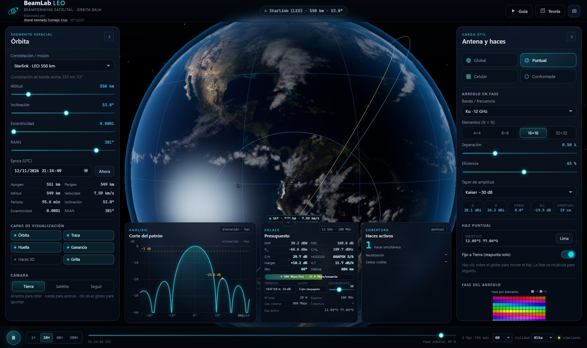
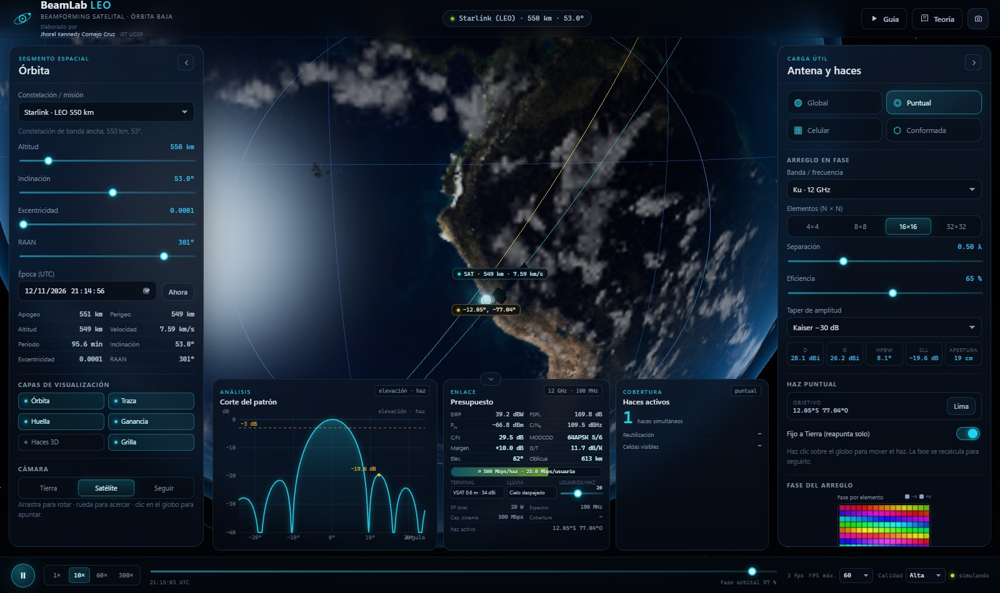
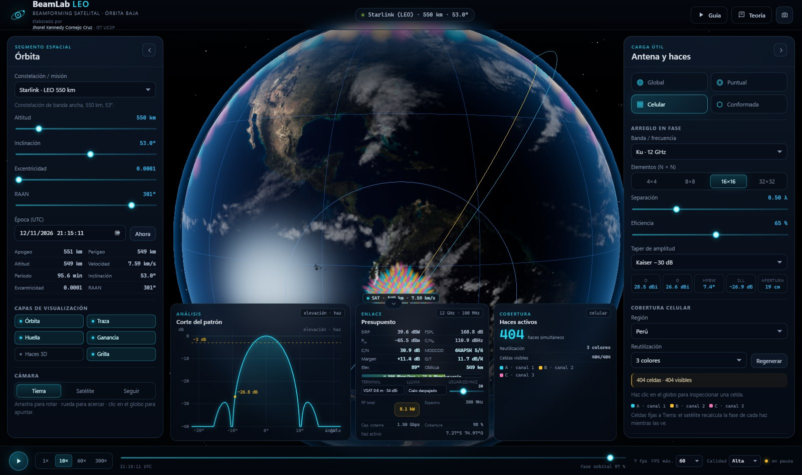
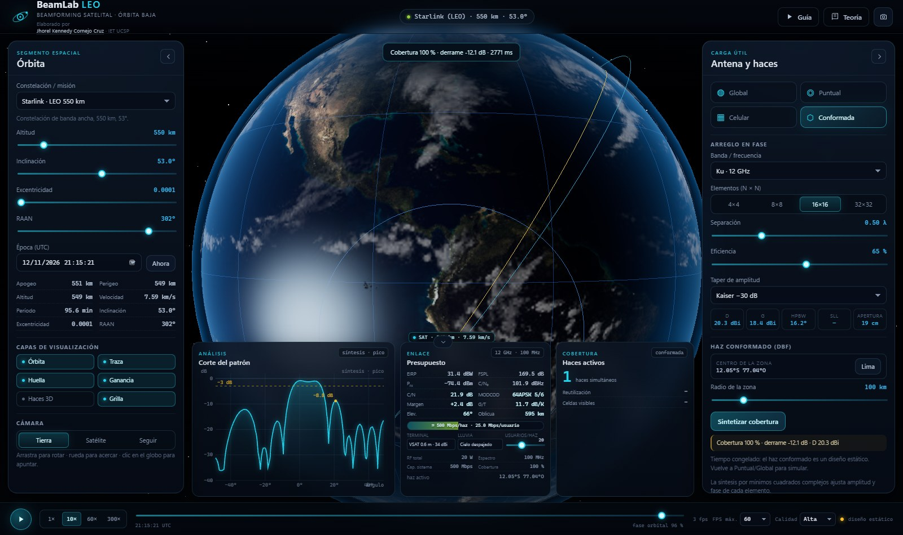

# Guion de exposición — BeamLab LEO

### La historia de una antena que no se mueve

**Demo en vivo:** <https://gcrownv-glitch.github.io/beamlab-leo/>  
**Repositorio:** <https://github.com/gcrownv-glitch/beamlab-leo>  
**Versión PDF (para imprimir o tablet):** [guion-beamlab-leo.pdf](guion-beamlab-leo.pdf) 
**Elaborado por:** [Jhorel Kennedy Cornejo Cruz](https://github.com/gcrownv-glitch) · IET UCSP

> **La idea en una frase:** un satélite en órbita baja no puede iluminar toda la Tierra con una sola antena; reparte su potencia en muchos haces pequeños y puede moverlos **sin mover nada**, solo cambiando el tiempo (la fase) con que emite cada antena.

  
  
  
  

*Cuatro vistas de la app: general, satélite, celular y conformado.*

> **Cómo usar este guion:** no lo memorices palabra por palabra. Lee las frases en negrita, mira las imágenes y sigue las escenas. Si te pierdes, vuelve a “luz, foco, mapa” y a las tres C. Cada fórmula tiene una frase que la traduce.

### La exposición en 30 segundos

> “Un satélite LEO se mueve a 7,6 km/s y solo ve un casquete de la Tierra. Para dar internet, no usa una antena gigante: usa 256 antenitas que emiten con pequeños retrasos. Eso mueve el haz sin mover la antena. Con muchos haces cubre un país; con un haz con forma cubre una ciudad. Y siempre hay un compromiso entre cobertura, potencia y capacidad.”

---

## Antes de empezar: lo que quiero que recuerden

No hace falta memorizar el guion. Memoriza **tres ideas**, **tres palabras** y **tres números**.

### Las 3 ideas (luz, foco, mapa)

1. **La luz:** el satélite no ve toda la Tierra; ve un casquete de unos 2.560 km de radio (~5.100 km de diámetro). Y se mueve a 7,6 km/s.
2. **El foco:** para mover el haz no se mueve la antena; se cambia la fase de cada elemento. Es una orquesta de 256 antenitas.
3. **El mapa:** para cubrir un país se usan cientos de haces pequeños; para una zona, un haz con forma. Siempre hay un compromiso entre **cobertura**, **concentración** y **capacidad**.

### Las 3 C (el triángulo del diseño)

| C | Qué significa | Se mide con |
|---|---|---|
| **Cobertura** | cuánta Tierra iluminas | km de huella, número de celdas |
| **Concentración** | cuánta potencia pones en cada punto | dBi, HPBW |
| **Capacidad** | cuántos datos caben | C/N₀, reutilización de frecuencia |

> **Frase para recordar:** “No se pueden maximizar las tres C al mismo tiempo. El beamforming mueve el equilibrio.”

### Los 3 números

- **550 km** de altura.
- **~400 celdas** para cubrir Perú.
- **100 %** de cobertura del haz conformado sobre Lima.

### Mapa de la exposición

| # | Escena | # | Escena |
|---|---|---|---|
| 1 | El satélite que no se queda quieto | 5 | Cubrir un país: el panal |
| 2 | El problema: una lámpara no alcanza | 6 | Un haz con forma de Lima |
| 3 | La solución: una orquesta de antenas | 7 | ¿Llega la señal? El presupuesto |
| 4 | El precio de concentrar | 8 | Cierre: las tres ideas |

*Cada escena lleva su tiempo orientativo en el título.*

**Antes de entrar:** abre la URL, prueba **Guía** una vez, deja **FPS máx. 60** y **Calidad Alta** (o 30/Baja si la PC es débil), y ten a mano las capturas de `../img/` por si falla internet.

---

## Escena 1 · El satélite que no se queda quieto

**Tiempo:** 0:40–2:00  
**Muestra:** app en **Puntual**, constelación **Starlink**, cámara **Satélite** o **Seguir**; activa **Órbita**, **Traza** y **Huella**.

**Di algo así:**

- “¿Han visto una antena parabólica? El satélite de televisión parece quieto porque está a 35.786 km, en órbita geoestacionaria. Este no: está a 550 km y da una vuelta a la Tierra cada 95 minutos.”
- “Se mueve a 7,6 km/s. Para que se hagan una idea, de Lima a Arequipa hay unos 1.000 km: este satélite los recorre en poco más de dos minutos.”
- “Desde 550 km no ve toda la Tierra. Ve un casquete de 67° alrededor de la vertical, un disco de unos 2.560 km de radio (~5.100 km de diámetro): más o menos de Lima a Miami. Ese es su ‘campo de visión’.”
- “La ventaja de LEO es que está cerca: menos retardo y más señal. El precio es que se mueve y hay que repartir la cobertura.”

**Frase para recordar:** “El satélite no ve la Tierra; ve una ventana.”

**Dato con interpretación:** 550 km es casi la distancia Lima–Cusco; 95 minutos es una clase y media; el disco visible tiene el tamaño de un continente.

**Si preguntan “¿por qué no usan GEO?”:** “GEO cubre mucho con un solo haz, pero está lejos: más retardo y menos señal. LEO está cerca, pero se mueve y necesita muchos haces. Son compromisos distintos.”

---

## Escena 2 · El problema: una lámpara no alcanza

**Tiempo:** 2:00–3:30  
**Muestra:** modo **Global**; luego **Puntual** con objetivo **Lima**. Compara el tamaño de la huella y las métricas del panel.

**Di algo así:**

- “Con un haz muy ancho, como una lámpara de ambiente, iluminamos casi todo el disco. Pero la potencia se reparte: la ganancia es de unos 5 dBi.”
- “Con un haz puntual, como una linterna, iluminamos solo Lima. La ganancia sube a unos 29 dBi.”
- “La diferencia entre 5 y ~29 dBi es de 24 dB. En potencia, 24 dB es unas 250 veces. Es la diferencia entre una lámpara que ilumina toda la sala y una linterna que apunta a una pared.”
- “Ojo con un detalle del apunte: la bocina de 17° es de un satélite GEO. Desde LEO, 17° solo ilumina unos 160 km. Para cubrir el disco visible desde LEO haría falta un haz de 134°, y la ganancia cae a 5 dBi.”

**Qué es dBi (en simple):**

> dBi no es un voltaje ni una potencia absoluta. Es una forma de decir **cuántas veces concentra** la antena la potencia en una dirección, comparada con una antena ideal que reparte por igual en todas direcciones.
>
> - **0 dBi** = reparte por igual, como una vela.
> - **3 dB** = 2 veces.
> - **10 dB** = 10 veces.
> - **~29 dBi** ≈ 800 veces.
> - **5 dBi** ≈ 3 veces.

**Frase para recordar:** “No se puede tener cobertura total y mucha ganancia con una sola antena.”

**Dato con interpretación:** ~29 dBi no significa 29 vatios; significa que la antena concentra como si tuviera ~800 veces más potencia en esa dirección.

**Si preguntan “¿y por qué no ponen más potencia?”:** “Porque el satélite tiene límite de energía, calor y peso. Es más eficiente concentrar la potencia con la antena que subir la potencia del transmisor.”

---

## Escena 3 · La solución: una orquesta de antenas

**Tiempo:** 3:30–5:30  
**Muestra:** cámara **Satélite**; señala el panel de la antena y el **mapa de fase** del panel derecho.

**Di algo así:**

- “La antena no se mueve. Lo que cambia es el **tiempo** con el que emite cada elemento.”
- “Imaginen 256 personas en una tribuna haciendo una ola. Si todos levantan la tarjeta al mismo tiempo, la ola no va a ningún lado. Si cada uno la levanta un poquito después que el anterior, la ola viaja hacia donde ustedes quieren. Aquí pasa lo mismo, pero con ondas de radio.”
- “Cada antenita emite la misma señal con un pequeño retraso. En la dirección de Lima, todas las ondas llegan en fase y se suman. En otra dirección, se cancelan. Eso es **beamforming**.”
- “El mapa de fase es ese arcoíris: cada color es un retraso distinto. El arcoíris se repite porque la fase da vueltas cada 360°, pero lo importante es la **dirección de la rampa**, no el color.”

**La fórmula, con interpretación:**

\[
\varphi_{mn} = -k\,(x_m u_0 + y_n v_0)
\]

- \(\varphi\): el retraso (fase) de cada elemento.
- \(x_m, y_n\): la posición de cada antenita en el panel.
- \(u_0, v_0\): la dirección a la que queremos apuntar (Lima).
- \(k = 2\pi/\lambda\): cuánto cambia la onda por unidad de distancia.

> En una frase: “la fase es un retraso; la rampa de fase inclina el frente de onda y apunta el haz.”

**Frase para recordar:** “No movemos la antena; movemos el tiempo.”

**Dato con interpretación:** el panel tiene 256 elementos y mide unos 19 cm (como una pizza mediana). No hay motores: todo es electrónica.

**Si preguntan “¿cómo sabe dónde está Lima?”:** “Con su posición orbital y el modelo de la Tierra; el software calcula el retraso para cada elemento. En un sistema real se agrega calibración y seguimiento.”

---

## Escena 4 · El precio de concentrar

**Tiempo:** 5:30–6:45  
**Muestra:** cambia **4×4 → 16×16**; mueve **Separación** a 0,8 λ; cambia **Taper** de Uniforme a **Kaiser −30 dB**.

**Di algo así:**

- “Con 4×4 el haz mide unos 25° y la huella es enorme. Con 16×16 baja a unos 7° y la ganancia sube a ~29 dBi.”
- “La regla es simple: si duplicas el tamaño del panel, el haz se estrecha a la mitad. Es como ponerle un lente más grande a una linterna: más concentrado, pero iluminas menos área.”
- “El **taper** es bajar la potencia en los bordes del panel. Eso reduce los **lóbulos laterales**: esa luz que se escapa por los costados y puede interferir con otras celdas. El precio es un haz un poco más ancho y algo menos de ganancia.”
- “Si separo los elementos más de 0,5 λ, aparecen **lóbulos de difracción**: copias del haz en otras direcciones. Por eso los arreglos reales usan ~0,5 λ.”

**Fórmulas, con interpretación:**

\[
\theta_{3\text{dB}} \approx 0{,}886\,\frac{\lambda}{L}
\]

- \(\theta_{3\text{dB}}\): el ancho del haz a media potencia.
- \(\lambda\): la longitud de onda (unos 2,5 cm en Ku).
- \(L\): el tamaño del panel.

> “Si \(L\) se duplica, \(\theta\) se reduce a la mitad: panel más grande, haz más fino.”

**Frase para recordar:** “Apertura más grande = haz más fino; taper = menos lados, menos ganancia.”

**Dato con interpretación:** 16×16 con 0,5 λ en Ku mide 19 cm y da ~29 dBi; 4×4 da un haz 4 veces más ancho.

**Si preguntan “¿qué es SLL?”:** “El nivel de los lóbulos laterales. Es la luz que se escapa por los costados del haz. Uniforme ronda −13 dB; Kaiser −30 dB baja mucho más, a costa de ensanchar el haz principal.”

---

## Escena 5 · Cubrir un país: el panal

**Tiempo:** 6:45–8:15  
**Muestra:** modo **Celular**, región **Perú**, **3 colores**; observa el número de haces y la rejilla.

**Di algo así:**

- “Perú es demasiado grande para un solo haz. Se cubre con un panal de unos ~400 haces pequeños.”
- “Cada celda tiene su propio haz. Los colores son **reutilización de frecuencia**: celdas del mismo color usan el mismo canal, como un mapa con tres colores. Así se reutiliza el espectro, que es un recurso escaso.”
- “Las celdas están fijas a Tierra. El satélite recalcula la fase de cada una mientras la ve; las que caen bajo el horizonte o muy cerca del borde se apagan.”
- “Es como regar un jardín con ~400 aspersores pequeños en vez de una manguera gigante: cubres todo, pero cada aspersor tiene su caudal y su control.”

**Frase para recordar:** “Para cubrir un país, muchos focos pequeños; para una zona, un foco con forma.”

**Dato con interpretación:** ~400 celdas, 3 colores, unos 26 dBi por celda y C/N₀ cercano a 110 dBHz en el centro. Más celdas = más capacidad, pero más complejidad y más interferencia potencial.

**Si preguntan “¿cuántos satélites se necesitan?”:** “Depende de la constelación. Aquí vemos un satélite; en una constelación, varios comparten la cobertura y se pasan las celdas entre ellos (handover).”

---

## Escena 6 · Un haz con forma de Lima

**Tiempo:** 8:15–9:45  
**Muestra:** modo **Conformada**, centro **Lima**, radio **100 km**, pulsa **Sintetizar cobertura**.

**Di algo así:**

- “Ahora no queremos un punto, queremos una zona: Lima metropolitana.”
- “La antena no puede mover un reflector. Lo que hace es combinar la amplitud y la fase de los 256 elementos para que el haz tenga **forma de mancha**, no de círculo.”
- “El software resuelve un problema de ajuste: que el campo valga 1 dentro de la zona y 0 fuera. Es como un ajuste de mínimos cuadrados, pero con ondas.”
- “Resultado: 100 % de cobertura, derrame de −12,1 dB y 20,3 dBi. El haz se ensanchó a 16,2°, justo el tamaño de la zona.”

**La fórmula, con interpretación:**

\[
\min_{\mathbf w}\;\|A\mathbf w-\mathbf d\|^2+\lambda\|\mathbf w\|^2
\]

- \(\mathbf w\): los pesos (amplitud y fase) de cada elemento.
- \(A\): cómo contribuye cada elemento en cada punto de la Tierra.
- \(\mathbf d\): 1 dentro de Lima, 0 fuera.
- \(\lambda\): un freno para que la solución no se vuelva loca.

> En una frase: “buscamos los pesos que hacen que las ondas se sumen dentro de Lima y se cancelen fuera.”

**Frase para recordar:** “El haz deja de ser un círculo y se vuelve una mancha con forma de Lima.”

**Dato con interpretación:** 20,3 dBi es ~150 veces; el haz puntual era ~29 dBi (~800 veces). Cambiamos concentración por cobertura: menos potencia por punto, pero toda Lima iluminada.

**Si preguntan “¿esto existe en la vida real?”:** “Sí, es la versión digital de un reflector con varios alimentadores, como los que menciona el apunte. En vez de mover un reflector, se ajustan amplitudes y fases.”

---

## Escena 7 · ¿Llega la señal? El presupuesto de enlace

**Tiempo:** 9:45–11:00  
**Muestra:** tarjeta **Presupuesto** (EIRP, FSPL, Prx, C/N₀, C/N, MODCOD, margen, G/T, elevación, oblicua, capacidad).

**Di algo así:**

- “La ganancia del haz entra en el **EIRP**: la potencia efectiva que el satélite parece tener en esa dirección. Aquí son unos 39 dBW, equivalentes a unos 8 kW efectivos, pero concentrados en un haz.”
- “La distancia juega en contra: la **pérdida de espacio libre** es de unos 170 dB a 611 km. La señal llega muy débil: del orden de −66 dBm en una terminal de 0,6 m.”
- “El **C/N₀** compara la señal con el ruido: 109,6 dBHz. Pero C/N₀ solo no dice si el enlace sirve: con 100 MHz, eso equivale a **C/N = 29,6 dB**. Con 71 dBHz y 100 MHz tendríamos **−9 dB**, y no habría enlace. Por eso el medidor ahora muestra el **margen frente al umbral del MODCOD**, no C/N₀ a secas.”
- “Con C/N 29,6 dB, el módem puede usar **64APSK 5/6**: 5 bits/s/Hz, es decir, unos **500 Mbps por haz**. Si repartimos ese haz entre 20 usuarios, son unos **25 Mbps por usuario**.”
- “Si llueve y perdemos 8 dB, el C/N baja a ~21,6 dB y el sistema elige un MODCOD más robusto. Si el C/N cae por debajo del umbral, la tarjeta dice **sin enlace** y la capacidad es cero.”

**Las fórmulas, con interpretación:**

\[
\text{EIRP}=P_{tx}+G_{tx}\qquad
L_{fs}=20\log_{10}\!\left(\frac{4\pi d}{\lambda}\right)\qquad
\frac{C}{N_0}=P_{rx}-N_0\qquad
\frac{C}{N}=\frac{C/N_0}{B}
\]

- **EIRP:** potencia del transmisor + ganancia de la antena. “Lo que el satélite ‘parece’ tener en esa dirección.”
- **Pérdida de espacio libre:** la señal se diluye con la distancia. “Como una lámpara que ilumina menos cuanto más lejos.”
- **C/N₀:** señal frente a ruido por hertz. “Qué tan fuerte es la música frente al ruido de fondo.”
- **C/N:** C/N₀ repartido en el ancho de banda. “El mismo ruido, escuchado con una ventana más ancha, empeora.”

**MODCOD y margen:** cada modulación necesita un C/N mínimo. El simulador elige el MODCOD más alto que cabe con 1 dB de margen de implementación. Si ninguno cabe, hay outage.

**La escala de dB, en simple:**

- 3 dB = 2 veces.
- 10 dB = 10 veces.
- 20 dB = 100 veces.
- 24 dB ≈ 250 veces.

**Frase para recordar:** “C/N₀ solo no basta: el ancho de banda y el umbral del módem deciden si hay internet.”

**Dato con interpretación:** 39 dBW ≈ 8 kW efectivos; 169,7 dB de FSPL a 611 km; C/N₀ 109,6 dBHz; C/N 29,6 dB; 64APSK 5/6; 500 Mbps/haz; 25 Mbps/usuario con 20 usuarios. Con antena isotrópica (0 dBi) el mismo enlace queda en outage: eso explica los antiguos 0–3 Mbps.

**Si preguntan “¿por qué no suben la potencia?”:** “Porque el satélite tiene límites de energía, calor y peso. Es más eficiente mejorar la antena y la cobertura que subir vatios. Además, ~400 haces a 20 W serían ~8 kW de RF: en un satélite real la potencia se comparte.”

---

## Escena 8 · Cierre: las tres ideas

**Tiempo:** 11:00–11:45  
**Muestra:** vuelve a **Puntual** o deja la vista general; señala la URL.

**Di algo así:**

- “Recuerden tres ideas: **la luz** —el satélite ve un casquete, no la Tierra—; **el foco** —mover el haz es cambiar fases, no motores—; **el mapa** —para cubrir un país, muchos haces; para una zona, un haz con forma.”
- “Y recuerden las tres C: **cobertura, concentración y capacidad**. No se pueden maximizar las tres; el diseño elige.”
- “BeamLab LEO es un simulador abierto: pueden mover el satélite, cambiar el arreglo, ver la fase, generar cientos de celdas y diseñar un haz conformado. El código y la demo están en GitHub.”

**Frase de cierre:** “En LEO no se cubre con un haz, se cubre con muchos; y cada haz es un compromiso.”

**Cierre de 15 segundos:** “Gracias. La demo está en `gcrownv-glitch.github.io/beamlab-leo`; el repositorio, en GitHub. ¿Preguntas?”

---

## Glosario para no ingenieros

| Término | Qué significa | Analogía |
|---|---|---|
| **LEO** | órbita baja, ~550 km; el satélite se mueve rápido | un dron que pasa |
| **GEO** | órbita geoestacionaria, 35.786 km; parece quieto | un faro fijo |
| **dBi** | cuánto concentra la antena respecto a una que reparte por igual | el zoom de una linterna |
| **dB** | escala relativa: +3 dB = 2×, +10 dB = 10× | el volumen del equipo de sonido |
| **HPBW** | ancho del haz a media potencia | el ancho del cono de la linterna |
| **SLL** | nivel de los lóbulos laterales | la luz que se escapa por los costados |
| **EIRP** | potencia efectiva del satélite en una dirección | la potencia “aparente” del foco |
| **FSPL** | pérdida por distancia | la luz se diluye con la distancia |
| **C/N₀** | señal frente a ruido | qué tan fuerte se oye la música sobre el ruido |
| **Fase** | retraso pequeño de cada antena | cada músico entra un instante después |
| **Beamforming** | mover el haz cambiando fases | una orquesta que apunta el sonido |
| **Huella** | zona de la Tierra que ilumina el haz | el círculo de luz en el piso |
| **Reutilización** | repetir el mismo canal en celdas separadas | colores de un mapa |
| **Taper** | bajar la potencia en los bordes del panel | suavizar el borde del foco |

---

## Números con interpretación

| Número | Qué significa | Comparación |
|---|---|---|
| **550 km** | altura del satélite | casi Lima–Cusco |
| **7,6 km/s** | velocidad orbital | Lima–Arequipa en ~2 min |
| **95 min** | una vuelta a la Tierra | una clase y media |
| **67°** | ángulo visible desde la vertical | un casquete, no la Tierra entera |
| **2.560 km** | radio del disco visible (~5.100 km de diámetro) | Lima–Miami de extremo a extremo |
| **256** | elementos del arreglo 16×16 | 256 antenitas |
| **19 cm** | tamaño del panel en Ku | una pizza mediana |
| **~29 dBi** | directividad del haz puntual (G ≈ 26 dBi con η = 65 %) | ~800× respecto a una antena ideal |
| **7°** | ancho del haz puntual | huella de ~70 km a nadir |
| **~400** | celdas para Perú | un panal de haces |
| **100 km** | radio de la zona conformada | Lima metropolitana |
| **100 %** | cobertura lograda | derrame −12,1 dB |
| **20,3 dBi** | directividad del haz conformado | ~150×; menos que ~29 dBi, pero cubre Lima |
| **39 dBW** | EIRP del enlace | ~8 kW efectivos |
| **169,7 dB** | pérdida de espacio libre a 611 km | atenuación enorme |
| **109,6 dBHz** | C/N₀ del enlace | C/N 29,6 dB en 100 MHz |
| **64APSK 5/6** | MODCOD seleccionado | 5 bits/s/Hz |
| **500 Mbps** | capacidad agregada por haz | 25 Mbps/usuario con 20 usuarios |
| **−12,1 dB** | derrame fuera de la zona | ~6 % de la potencia |
| **0,5 λ** | separación entre elementos | evita copias del haz |

> **Para los que quieran el detalle:** \(G(\text{dBi})=10\log_{10}G\); \(D=4\pi A/\lambda^2\); \(HPBW\approx0{,}886\lambda/L\); \(EIRP=P_{tx}G_{tx}\); \(FSPL=20\log_{10}(4\pi d/\lambda)\); \(C/N_0=P_{rx}-N_0\). No hace falta recitarlas: cada una tiene su interpretación en la tabla.

---

## Preguntas y respuestas (para público general)

**¿Por qué no usan una sola antena grande?**
Porque una antena grande concentra mucho en una zona pequeña. Para cubrir un país necesitas muchos haces o una antena gigante que no cabe en el satélite. El compromiso es cobertura vs. concentración.

**¿Cómo apuntan sin mover la antena?**
Cambiando el retraso (fase) de cada elemento. Las ondas se suman en la dirección deseada y se cancelan en las demás. No hay motores.

**¿Qué es dBi?**
Una medida de cuánto concentra la antena. 0 dBi reparte por igual; 3 dB es 2×; 10 dB es 10×; ~29 dBi es ~800×. No es una potencia absoluta.

**¿Por qué 0,5 λ?**
Para evitar los lóbulos de difracción, que son copias del haz en otras direcciones. Si separas más, aparecen copias que roban potencia y crean falsos objetivos.

**¿Por qué el apunte dice 17° y aquí usan 134°?**
Porque 17° es el haz global de un satélite GEO. Desde LEO, 17° solo cubre ~160 km; para el disco visible de LEO hace falta ~134°, con muy poca ganancia.

**¿Esto es real o solo un dibujo?**
Es un simulador didáctico con física realista: órbita kepleriana con corrección J2, arreglo en fase, Tierra esférica, enlace de espacio libre. No es un diseño de vuelo, pero los compromisos son reales.

**¿La PC de la universidad lo va a correr?**
Sí. Es una web estática; no necesita instalar nada. Si la GPU es débil, usa **30 fps + Calidad Baja** en la barra inferior.

**¿Se puede usar sin internet?**
Sí, con `npm run dev` en la laptop; también se puede servir en la red local. La URL pública necesita internet.

**¿Cuánto cuesta?**
El hosting es gratis (GitHub Pages). Un dominio propio cuesta ~US$ 10–15 al año; es opcional.

**¿Qué faltaría para un sistema real?**
Hardware, calibración de fase, handover entre satélites, interferencia, regulación, seguridad y miles de detalles más. Este proyecto muestra los conceptos y los compromisos.

---

## Versión de 5 minutos

Si el tiempo se acorta:

1. **0:00–0:45 · Gancho y órbita.** “Un satélite a 550 km se mueve a 7,6 km/s y solo ve un casquete de 2.560 km de radio.”
2. **0:45–2:00 · Problema y beamforming.** Global vs puntual; dBi; “no movemos la antena, movemos el tiempo”; muestra el mapa de fase.
3. **2:00–3:00 · El arreglo.** 4×4 vs 16×16; panel de 19 cm; ~29 dBi; taper y lóbulos.
4. **3:00–4:15 · Cobertura.** Celular Perú (~400 celdas, 3 colores); conformada Lima (100 km, 100 %).
5. **4:15–5:00 · Enlace y cierre.** EIRP/FSPL/C/N₀; las 3 C; URL.

---

## Si la demo falla

| Problema | Solución |
|---|---|
| No hay internet | Usa las capturas de `../img/` y explica con ellas. |
| El satélite ya no ve Lima | Pulsa **Ahora** o cambia a **Celular/Conformada** (se reposiciona y pausa). |
| La síntesis da error | Baja el radio a 80–100 km o sube a 20×20/32×32. |
| La PC va lenta | **FPS máx. 30**, **Calidad Baja**, 4×4 u 8×8, desactiva **Ganancia**. |
| El proyector no muestra el 3D | Abre `../img/02-satelite.jpg`, `04-celular.jpg`, `05-conformado.jpg`. |

**Plan de 60 segundos:** “Un satélite LEO ve un casquete; para cubrirlo usa muchos haces; mueve cada haz cambiando fases, no motores; y elige entre cobertura, concentración y capacidad.”

---

## Chuleta final (una página)

**3 ideas:** luz (casquete) · foco (fases) · mapa (muchos haces).

**3 C:** cobertura · concentración · capacidad.

**3 números:** 550 km · ~400 celdas · 100 %.

**3 frases:**
1. “El satélite no ve la Tierra; ve una ventana.”
2. “No movemos la antena; movemos el tiempo.”
3. “En LEO no se cubre con un haz, se cubre con muchos.”

**3 clics:**
1. **Puntual** → **Satélite** → mapa de fase.
2. **Celular** → **Perú** → ~400 haces.
3. **Conformada** → **Lima** → **Sintetizar**.

**dBi en 10 segundos:** 0 = todas las direcciones; 3 dB = 2×; 10 dB = 10×; ~29 dBi ≈ 800×.

**Si te pierdes:** vuelve a “luz, foco, mapa” y a las tres C. No necesitas recitar fórmulas; cada fórmula tiene una frase que la explica.

---

**Demo:** <https://gcrownv-glitch.github.io/beamlab-leo/>  
**Repositorio:** <https://github.com/gcrownv-glitch/beamlab-leo>  
**Teoría completa:** [teoría](../teoria.md) · **Despliegue:** [despliegue](../deploy.md)
